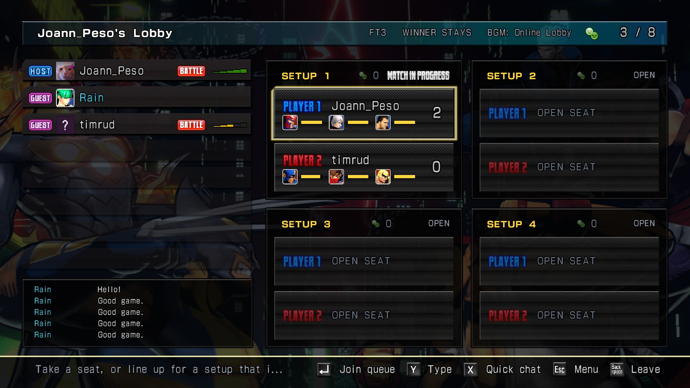

Timestone (MVC3 Rollback) :steamhappy:

# About

<a href="doc/screenshot.jpg"></a>

This is a work in progress rollback mod for UMVC3. 

Timestone currently has semi functional rollback/netplay but is not considered finished or tournament-ready.

The current research of MVC3 (in a Ghidra DB) made throughout this project will be made publically available later, but please contact me on Discord if you are going to contribute and want a copy.

The db was brought to you in part by [Mario Party Challenge World](https://www.youtube.com/watch?v=VIZWiDssOmA), a Capcom made japan exclusive mario party gambling arcade game with a real roulette table and real balls, which has been invaluable to understanding MVC3's engine accurately. Mario Party for some reason, has the most similar version of MT Framework that MVC3 runs on, and so happens to have a PDB with function names, enums, and struct member information included.

[Thanks to Aeyth8 for dumping the arcade cabinet.](https://www.reddit.com/r/lostmedia/comments/1jvlauo/found_mario_party_mystery_challenge/)

AI has been used extensively throughout this project for reverse engineering, code generation, debugging, investigation, and repetitive work. The generated output is tested, modified, or discarded as needed.

# Compilation

Primary development is done on linux, with MinGW-w64. 
You need a MinGW-w64 toolchain (gcc, g++, windres, binutils) make and zip. Try WSL first on windows, or use MSYS2 with the MinGW64 shell.

    make release     # -> Timestone.asi + TimestoneUpdater.exe (+ Timestone.zip)

NixOS:    nix develop -c make release       (or: nix build .#timestone)
Windows:  in an MSYS2 MINGW64 shell, first `pacman -S mingw-w64-x86_64-toolchain make zip`, then `make release`.

# Command line options

Use `-five-bars` with a training launch to start both teams with five hyper bars
(and every Frank at level 3).

The game boots into the in-game online menu by default. 
Use `-launcher` (or `[Launch] NativeLobby=0` in `Timestone.ini`) for the dev launcher
instead. 

For AI-assisted desync investigation, there is a semi reliable autotester for moves from the attack command matcher. It supports move names, and move numbers (from the command matcher), though this method is deprecated in favor of match desync dumps.

```text
umvc3.exe -autotest=Ryu -autotest-moves="12,Hadoken" -autotest-repeat=5
``

Typically you would use it with the autotest_ai.py in the tools folder.

```text
python tools/autotest_ai.py --character Hawkeye \
  --failed-tsv "../ULTIMATE MARVEL VS. CAPCOM 3/autotest/failed.tsv" \
  --repeat 5 --launch
```


# Credits

Armonte- Many reverse engineering and documentation, Shot snapshot base, inspiration from his repo (exception handler.. etc)

HkHaan- Prior reverse engineering, the one who started it all with the OG UMVC3Rollback repo

catboy_friender (Sheep)- Help with HkHaan's repo, prior reverse engineering

Eternal Yoshi- Prior reverse engineering, ThreeWorkTool, playtesting

Ryn (wistfulhopes), anotak, Gneiss, tabsmvc, EddieLopes, dantarion, tge-was-taken - Prior reverse engineering

Archeroflegend- Framestepper, playtesting and harassment

Vevota- Playtesting and harassment

Jasongamedev- Playtesting

//FIXMESTEVE: : Standby support

John2143- "Sponsorship", build help and signing, discord bot

ermaccer- UMVC3Hook

ThirteenAG- Ultimate ASI Loader


Those random guys who played with me in an ingame lobby one day


# Third-Party Licenses

Licenses for code used in this project are available in [THIRDPARTYNOTICES](THIRDPARTYNOTICES).
These licenses cover only their projects, not all of Timestone. Timestone licensing is undecided.

| Component | License / notices |
| --- | --- |
| [ermaccer/UMVC3Hook](https://github.com/ermaccer/UMVC3Hook) | Permission granted by ermaccer: "just keep any edits of my work open source." |
| [4423Q/UMVC3Rollback](https://github.com/4423Q/UMVC3Rollback) | HkHaan's work with catboy_fucker, used with permission |
| [ENet 1.3.18](https://github.com/lsalzman/enet) | MIT, Lee Salzman |
| [Dear ImGui, including backends](https://github.com/ocornut/imgui) | MIT, Omar Cornut, v1.85 WIP |
| [kiero 1.2.6](https://github.com/Rebzzel/kiero) | MIT, Rebzzel |
| [MinHook](https://github.com/TsudaKageyu/minhook) | BSD-2-Clause, Tsuda Kageyu |
| Hacker Disassembler Engine inside MinHook | BSD-2-Clause, Vyacheslav Patkov; full HDE32/HDE64 notices included |
| [stb_vorbis and ImGui's three imstb headers](https://github.com/nothings/stb) | MIT OR Unlicense, Sean Barrett, MIT used |
| [ProggyClean embedded font](https://github.com/bluescan/proggyfonts) | MIT, Tristan Grimmer, separate from ImGui's notice |
| [ModUtils helpers](https://github.com/CookiePLMonster/ModUtils) | MIT, Adrian Zdanowicz (Silent), (CitizenFX scanner needs a license check) |
| Archer's framestepper | MIT, Archer; see [the repo](https://github.com/ArcherOfLegend/FrameStepper) |
| [Ultimate ASI Loader 9.7.2 x64](https://github.com/ThirteenAG/Ultimate-ASI-Loader) | MIT, ThirteenAG; bundled as dinput8.dll |
| miniz inside Ultimate ASI Loader | MIT, RAD Game Tools/Valve and Rich Geldreich/Tenacious Software |
| [FunctionHookMinHook wrapper inside the loader](https://github.com/ThirteenAG/injector) | MIT, praydog, injector zlib and exception-tracer public-domain notices also included |
| ImGui Japanese glyph-range dataset | CC BY-SA 2.1 Japan per the vendored notice; IPA Japan attribution and license URI preserved |
| [Statically linked MinGW-w64 runtime](https://github.com/mingw-w64/mingw-w64) | Mixed runtime licenses; complete 8.0.0 notice bundle included for the local toolchain; other release toolchains need their matching notices |
| [MCF Gthread](https://github.com/lhmouse/mcfgthread), if linked by the release toolchain | LGPL-3.0-or-later with additional permissions including GCC Runtime Library Exception 3.1; conditional notice included |

No license was found for [rdbo's ImGui/DirectX 9/kiero hook example](https://github.com/rdbo/ImGui-DirectX-9-Kiero-Hook).
